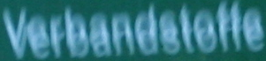
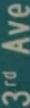
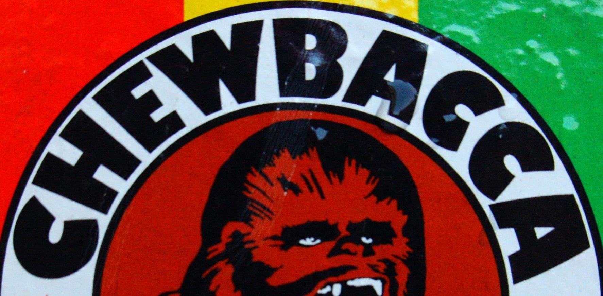

# Scene Text Image Super-Resolution (STISR)

Enhancing the clarity and readability of text in low-resolution images using PyTorch.

This project upscales blurry, low-resolution scene text crops (16×64) into sharp, high-resolution images (32×128) so that downstream text recognizers can read them more accurately. It combines a **MaxViT-based generator** with a **Text Prior (TP) module** that injects character-level knowledge from a pretrained recognizer (PARSeq) into every stage of the super-resolution network.

<p align="center">
  
  
  
</p>

---

## Table of Contents

- [Overview](#overview)
- [Architecture](#architecture)
- [Loss Function](#loss-function)
- [Dataset](#dataset)
- [Project Structure](#project-structure)
- [Installation](#installation)
- [Configuration](#configuration)
- [Usage](#usage)
- [Evaluation](#evaluation)
- [Acknowledgements](#acknowledgements)
- [License](#license)

---

## Overview

Generic super-resolution models optimize for pixel fidelity, which does not always translate into readable text. This project follows the **text-prior-guided** approach: a pretrained scene text recognizer predicts a character probability distribution from the (bicubic-upsampled) low-resolution input, and that prediction is used as a semantic guide while the generator reconstructs the image.

**Key ideas**

- **Text Prior module:** a pretrained [PARSeq](https://github.com/baudm/parseq) recognizer produces per-character log-probabilities, which a small CNN maps into a spatial feature map.
- **MaxViT generator:** multi-axis (block + grid) attention captures both local stroke detail and global word layout.
- **TP fusion at every stage:** text prior features are concatenated with each MaxViT stage output and fused through a 1×1 convolution plus a residual connection.
- **Sub-pixel upscaling:** two `PixelShuffle(2)` steps produce the final ×2 output (×4 relative to the internal feature map).
- **Recognition-aware evaluation:** results are measured with PSNR/SSIM *and* OCR accuracy from three recognizers (ASTER, MORAN, CRNN).

---

## Architecture

```
                 ┌──────────────────────────── Text Prior Module ───────────────────────────┐
 Interpolated LR │  PARSeq (pretrained)  ──►  log-softmax  ──►  ConvNet                     │
 (B,3,32,128) ──►│  (B,26,95)                (B,1,26,95)        (B,32,8,32)  = TP features   │
                 └──────────────────────────────────────────────────────┬───────────────────┘
                                                                        │
                 ┌────────────────────────────── Generator ─────────────▼───────────────────┐
 LR image        │  Conv stem (stride 2)                                                      │
 (B,3,16,64) ───►│      │  (B,128,8,32)                                                       │
                 │      ▼                                                                     │
                 │  MaxViT Stage 1 ─► concat(TP) ─► 1×1 conv ─► + skip ─┐                     │
                 │  MaxViT Stage 2 ─► concat(TP) ─► 1×1 conv ─► + skip ─┤                     │
                 │  MaxViT Stage 3 ─► concat(TP) ─► 1×1 conv ─► + skip ─┤ concat all stages   │
                 │  MaxViT Stage 4 ─► concat(TP) ─► 1×1 conv ─► + skip ─┘  ─► 1×1 proj ─► conv │
                 │                                                       (B,64,8,32)          │
                 │  Upscaler: conv ─► PixelShuffle×2 ─► conv ─► PixelShuffle×2 ─► conv ─► tanh │
                 └───────────────────────────────────────────────────────┬───────────────────┘
                                                                         ▼
                                                              SR image (B,3,32,128)
```

| Component | File | Details |
|---|---|---|
| Full model | `src/Model.py` | `model_sr` returns the SR image and the TP log-probabilities |
| Text Prior | `src/TP_Module.py` | PARSeq loaded via `torch.hub`, followed by a 2-layer CNN (`ConvNet`) |
| Generator | `src/model/Generator.py` | MaxViT backbone + upscaler, Xavier initialization |
| MaxViT | `src/model/MaxVit.py`, `src/model/MaxVit_comp.py` | 4 stages, depth 4 each, 128 channels, 4×4 window/grid, 32 heads |
| Upscaler | `src/model/upscaler.py` | Sub-pixel convolution, LeakyReLU, BatchNorm, dropout 0.5, `tanh` output in [-1, 1] |
| SRGAN-style alternative | `src/model/Generator_srgan.py` | Residual-block generator with TP input (experimental) |

---

## Loss Function

The total loss (`src/Loss/general_loss.py`) combines an image reconstruction term with two text prior consistency terms. The TP distribution of the LR input is pushed toward the TP distribution of the ground-truth HR image:

$$
\mathcal{L}_{total} = \gamma \cdot \mathcal{L}_{pix}(I_{SR}, I_{HR}) + \alpha \cdot \mathrm{KL}(TP_{LR} \,\|\, TP_{HR}) + \beta \cdot \lVert TP_{LR} - TP_{HR} \rVert_1
$$

| Term | Class | Weight (default) |
|---|---|---|
| Pixel-wise L1 between SR and HR | `CharbonnierLoss` (`Loss/SR_loss.py`) | `gamma = 5` |
| KL divergence between TP log-distributions | `TP_KlLoss` (`Loss/KL_loss.py`) | `alpha = 0.01` |
| L1 between TP log-distributions | `TP_L1Loss` (`Loss/TP_L1_loss.py`) | `beta = 0.1` |

> Note: despite its name, `CharbonnierLoss` currently computes a plain mean absolute error (no ε term).

**Learning rate schedule** (`src/LR_schedualer/LR_scheduler.py`): starting at `initial_lr`, the rate is multiplied by `decay_factor` (0.5) every 20 epochs until it reaches `final_lr`.

---

## Dataset

The model is trained and evaluated on **[TextZoom](https://github.com/JasonBoy1/TextZoom)**, a real-world STISR dataset of LR/HR text image pairs captured at different focal lengths. The LMDB files are included in this repository:

```
dataset/lmdb/str/TextZoom/
├── train1/
├── train2/
└── test/
    ├── easy/
    ├── medium/
    └── hard/
```

Each sample yields `(images_hr, images_lr, interpolated_image_lr, label_strs)`:

- `images_lr`: 3×16×64 low-resolution input
- `images_hr`: 3×32×128 ground truth
- `interpolated_image_lr`: bicubic-upsampled LR, fed to the Text Prior module
- `label_strs`: the ground-truth word

Images are normalized to [-1, 1] (see `src/Normalization_example/`).

Data loaders for synthetic (`--syn`) and mixed real/synthetic (`--mixed`) LR generation are also available in `src/dataset/dataset.py`.

---

## Project Structure

```
.
├── dataset/lmdb/str/TextZoom/       # TextZoom LMDB data
└── src/
    ├── main.py                      # Entry point
    ├── Model.py                     # model_sr = TP module + generator
    ├── TP_Module.py                 # Text Prior module (PARSeq + ConvNet)
    ├── config/
    │   └── super_resolution.yaml    # Main training/eval configuration
    ├── configs/                     # PARSeq (strhub) Hydra configs
    ├── interfaces/
    │   ├── base.py                  # Data loading, checkpoints, recognizer setup
    │   └── super_resolution.py      # TextSR: train / validate / OCR evaluation
    ├── model/
    │   ├── Generator.py             # MaxViT generator
    │   ├── Generator_srgan.py       # Alternative SRGAN-style generator
    │   ├── MaxVit.py, MaxVit_comp.py
    │   ├── upscaler.py
    │   ├── crnn/  moran/  recognizer/   # Evaluation recognizers (CRNN, MORAN, ASTER)
    ├── Loss/                        # Pixel, KL and L1 TP losses
    ├── LR_schedualer/               # Step-decay LR scheduler
    ├── dataset/                     # LMDB datasets and collate functions
    ├── strhub/                      # Vendored PARSeq code
    ├── utils/                       # PSNR/SSIM, label maps, converters, metrics
    ├── tools/                       # Dataset conversion utilities (from PARSeq)
    ├── demo_images/                 # Sample text images
    └── requirements/                # Detailed PARSeq requirement sets
```

---

## Installation

```bash
git clone https://github.com/zayn309/Scene-text-image-super-resolution-.git
cd Scene-text-image-super-resolution-

python -m venv venv
source venv/bin/activate        # Windows: venv\Scripts\activate

# PyTorch (choose the build for your CUDA version from pytorch.org)
pip install torch torchvision

# Project dependencies
pip install -r src/requirements.txt
pip install easydict pyyaml ipython python-Levenshtein opencv-python matplotlib tqdm six pillow
```

**Requirements:** Python 3.8+, a CUDA GPU is strongly recommended. The first run needs internet access because PARSeq is downloaded through `torch.hub.load('baudm/parseq', 'parseq', pretrained=True)`.

### Pretrained recognizers for evaluation

OCR evaluation uses pretrained ASTER, MORAN and CRNN weights (the same ones used by [TextZoom/TSRN](https://github.com/JasonBoy1/TextZoom)). Download them and set their paths in the config:

```yaml
TRAIN:
  VAL:
    aster_pretrained: 'path/to/aster.pth.tar'
    moran_pretrained: 'path/to/Moran.pth'
    crnn_pretrained:  'path/to/crnn.pth'
```

---

## Configuration

All settings live in `src/config/super_resolution.yaml`. The most important ones:

| Key | Default | Description |
|---|---|---|
| `TRAIN.train_data_dir` | `train1`, `train2` | Training LMDB folders |
| `TRAIN.batch_size` | 128 | Batch size (override with `--batch_size`) |
| `TRAIN.epochs` | 50 | Number of training epochs |
| `TRAIN.lr` | 0.001 | Adam learning rate (`beta1 = 0.5`) |
| `TRAIN.resume` | Colab Drive path | Checkpoint to resume from; set to `''` to train from scratch |
| `TRAIN.new_lr` | 5e-6 | Learning rate applied when resuming |
| `TRAIN.ckpt_dir` | `./ckpt/` | Where checkpoints are saved |
| `TRAIN.saveInterval` | 5 | Save a checkpoint every N epochs |
| `TRAIN.loss.{gamma,alpha,beta}` | 5, 0.01, 0.1 | Loss weights |
| `TRAIN.LR_Scheduler` | 1e-3 → 1e-5, ×0.5 | Step-decay schedule |
| `TRAIN.VAL.val_data_dir` | hard, easy, medium | Validation splits |
| `TRAIN.VAL.vis_dir` | `./demo/` | Visualizations and the loss plot |

> ⚠️ The default `resume` and pretrained recognizer paths point to Google Drive (`/content/drive/...`) from the original Colab setup. Update them before running locally.

---

## Usage

All commands are run from the `src/` directory, since paths in the config are relative to it.

```bash
cd src
```

### Training

`main.py` currently runs OCR evaluation. To train, change the body of `main()`:

```python
def main(config, args):
    Mission = TextSR(config, args)
    Mission.train()
```

Then run:

```bash
python main.py --batch_size 64
```

During training the script:

- logs the pixel, KL, TP-L1 and total losses plus PSNR/SSIM per epoch,
- validates on the **hard** split each epoch and saves LR/SR/HR comparison images with ASTER predictions,
- saves checkpoints every `saveInterval` epochs (keeping the best by total loss),
- writes a train/val loss curve to `<vis_dir>/loss_plot.png`.

### Evaluation

```bash
python main.py
```

This loads the checkpoint in `TRAIN.resume`, super-resolves the TextZoom test images and prints the word accuracy of CRNN, MORAN and ASTER on the SR outputs:

```
{'crnn': ..., 'moran': ..., 'aster': ...}
```

### Useful command-line options

| Flag | Description |
|---|---|
| `--batch_size N` | Override the config batch size |
| `--resume PATH` | Checkpoint path |
| `--vis_dir DIR` | Output folder for visualizations |
| `--syn` | Use synthetically downsampled LR images |
| `--mixed` | Mix synthetic and real LR images |

---

## Evaluation

| Metric | Implementation |
|---|---|
| PSNR | `utils/ssim_psnr.py` (computed on images rescaled to [0, 1]) |
| SSIM | `utils/ssim_psnr.py` |
| OCR word accuracy | ASTER, MORAN, CRNN on the SR output (`interfaces/super_resolution.py`) |

`eval_OCR()` currently reports accuracy on the **easy** split. To evaluate medium or hard, swap `self.val_loader_easy` for `self.val_loader_medium` or `self.val_loader_hard`.

---

## Acknowledgements

- [TextZoom / TSRN](https://github.com/JasonBoy1/TextZoom) for the dataset, data pipeline and the ASTER/MORAN/CRNN evaluation setup
- [PARSeq](https://github.com/baudm/parseq) for the pretrained text recognizer used as the text prior (vendored in `src/strhub`)
- [MaxViT: Multi-Axis Vision Transformer](https://arxiv.org/abs/2204.01697)
- [Text Prior Guided Scene Text Image Super-Resolution (TPGSR)](https://arxiv.org/abs/2106.15368) for the text-prior-guided SR idea

---

## License

This project is released under the [MIT License](LICENSE).
